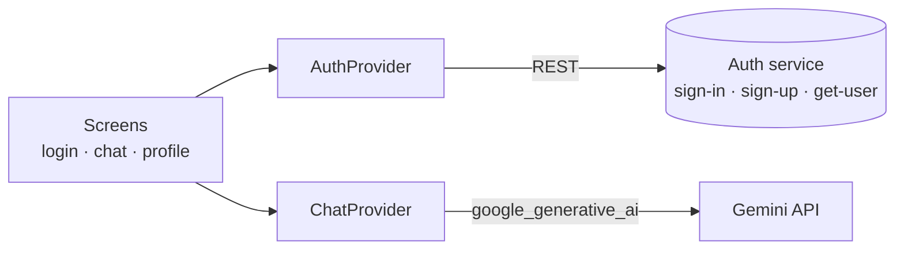

<div align="center">

# Gemini Chatbot

A cross-platform Flutter chat app powered by Google Gemini, with account sign-in and a
Markdown-rendered conversation view.


[](https://github.com/gitswagata1/gemini-chatbot-flutter/actions/workflows/ci.yml)


</div>

## Table of contents

- [Features](#features)
- [How it works](#how-it-works)
- [Getting started](#getting-started)
- [Configuration](#configuration)
- [Project structure](#project-structure)
- [Testing](#testing)
- [Security notes](#security-notes)
- [Roadmap](#roadmap)
- [Contributing](#contributing)
- [Citation](#citation)
- [License](#license)

## Features

- Chat with **Gemini 2.0 Flash** through the official `google_generative_ai` SDK
- **Markdown rendering** of replies: headings, lists, bold text and code
- **Sign-up, sign-in and profile** screens backed by a REST auth service
- Loading indicator, error handling and a one-tap **clear chat**
- Clean state management with `provider`
- One codebase for Android, iOS, web, Windows, macOS and Linux

## How it works



`AuthProvider` talks to a small REST service for accounts. `ChatProvider` owns the message
list, sends each prompt to Gemini and appends the reply, notifying the UI through
`ChangeNotifier`.

## Getting started

**Prerequisites**

- Flutter SDK 3.6 or newer
- A Gemini API key from [Google AI Studio](https://aistudio.google.com/app/apikey)

```bash
git clone https://github.com/gitswagata1/gemini-chatbot-flutter.git
cd gemini-chatbot-flutter
flutter pub get
flutter run --dart-define=GEMINI_API_KEY=your_api_key
```

To target a specific platform, add `-d chrome`, `-d windows` or a device id.

## Configuration

| Setting          | How to set it                                       | Default             |
| ---------------- | --------------------------------------------------- | ------------------- |
| `GEMINI_API_KEY` | `--dart-define=GEMINI_API_KEY=...` at build time    | none (required)     |
| Gemini model     | `ChatProvider` in `lib/provider/chat_provider.dart` | `gemini-2.0-flash`  |
| Auth service URL | `baseUrl` in `lib/provider/auth_provider.dart`      | hosted demo service |

## Project structure

```
gemini-chatbot-flutter/
├── lib/
│   ├── main.dart                 App entry point and provider setup
│   ├── models/
│   │   ├── chat_model.dart       ChatMessage
│   │   └── user_model.dart       User
│   ├── provider/
│   │   ├── auth_provider.dart    Sign-in, sign-up and profile requests
│   │   └── chat_provider.dart    Gemini client and message state
│   └── screens/
│       ├── login_screen.dart
│       ├── signup_screen.dart
│       ├── chat_page.dart        Conversation view with Markdown
│       └── profile_page.dart
├── test/                         Widget tests
├── android/ ios/ web/            Platform runners
├── windows/ macos/ linux/
├── pubspec.yaml
├── analysis_options.yaml         Lint rules
├── LICENSE
└── README.md
```

## Testing

```bash
flutter analyze
flutter test
```

## Security notes

- The Gemini key is supplied at build time and is never committed. Anything compiled into a
  client app can be extracted, so for a production release route Gemini calls through your
  own backend instead of shipping the key in the app.
- Restrict the key in Google AI Studio and rotate it if it is ever exposed.

## Roadmap

Planned work, ideas for taking the project further and open research questions are in
[ROADMAP.md](ROADMAP.md). Good first tasks are labelled
[`good first issue`](https://github.com/gitswagata1/gemini-chatbot-flutter/labels/good%20first%20issue).

## Contributing

Contributions are welcome. Read [CONTRIBUTING.md](CONTRIBUTING.md) and the
[Code of Conduct](CODE_OF_CONDUCT.md) first. To report a vulnerability, follow
[SECURITY.md](SECURITY.md).

## Citation

If you use this project in research or a product, you can cite it using
[CITATION.cff](CITATION.cff) (GitHub shows a "Cite this repository" button).

## License

Released under the [MIT License](LICENSE).

---

Built by **Swagata Banerjee** · [GitHub](https://github.com/gitswagata1)
